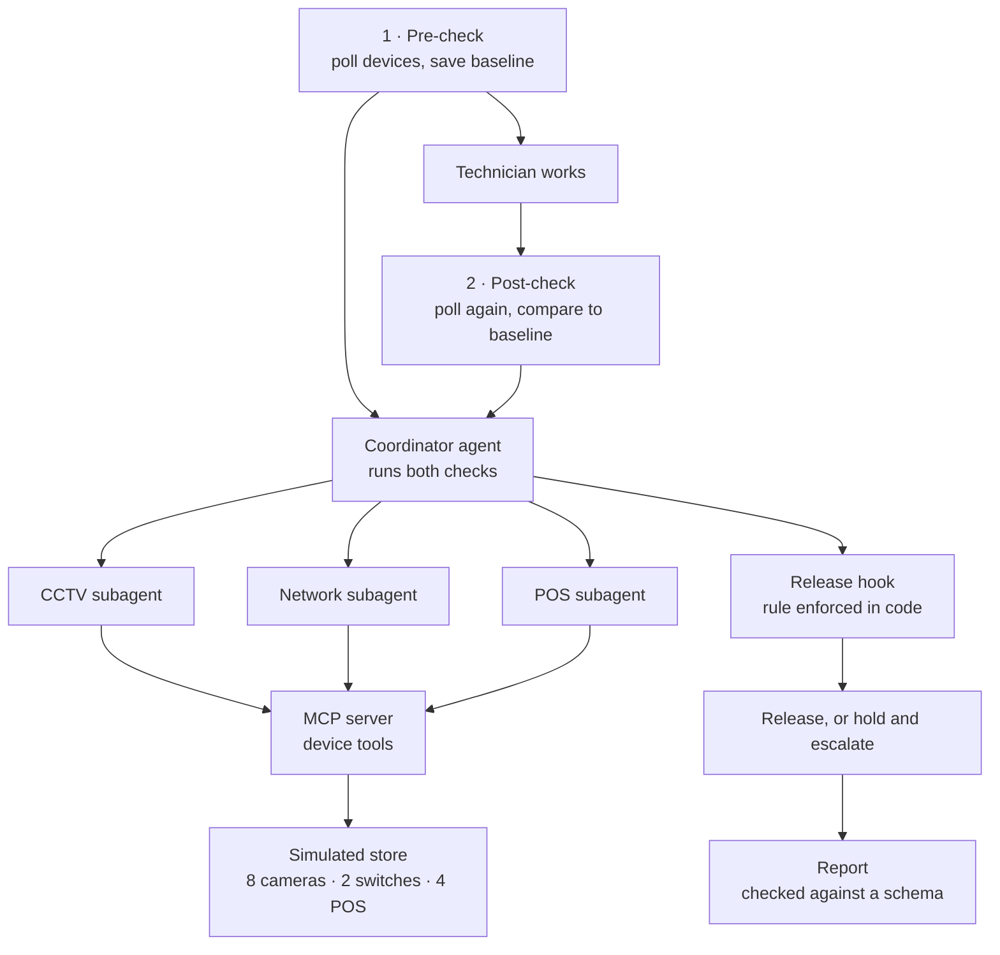

# Coordinator Agent

Pre-checks and post-checks a retail site around a technician visit, then decides whether the technician can be released. **The site is simulated**: there is no real hardware, only a simulator with fault injection.

Built with the Claude Agent SDK and an MCP server.

## What it does

1. **Pre-check.** Before the technician starts, the agent polls every device at the site and saves a baseline to disk.
2. **The technician works.** In this project that is simulated by injecting or clearing faults.
3. **Post-check.** The agent polls every device again and compares against the saved baseline.
4. **Decision.** Release the technician, or hold and escalate with the affected devices.



## The rules

- A device is `online`, `offline` or `unknown`. A tool timeout or error is `unknown`, never `online`.
- A device that was already offline in the pre-check is not a post-check failure. It is reported as `pre-existing`.
- The technician can be released only when the post-check has no new `offline` and no `unknown` devices.
- That last rule is enforced in code by a hook, not only asked for in the prompt. If the agent tries to release while a blocking fault is present, the hook refuses.
- The baseline is saved to disk and reloaded for the post-check. The agent never relies on conversation history to remember it.
- Every check ends with a report that is validated against a JSON schema, and an event log of tool calls, hook decisions, token usage and cost.

## Results

The agent was run against ten fault scenarios on the simulated store (one run each, `claude-haiku-5-5`, 2026-11-17):

- **Correct decisions:** 9 of 10
- **False releases:** 0. This is by design: a report says "release" only if the release hook let it through.
- **False holds:** 1. The agent held when the only offline device had already been offline before the visit.
- **Release attempts stopped by the code-level gate:** 0. The agent never tried to release when it should not have.
- **Right devices named as blocking:** 10 of 10
- **Reports that passed the schema:** 10 of 10
- **Cost per visit (pre-check plus post-check):** $0.0070 on average

Ten scenarios with one run each is a small sample: it shows the agent and the gate behave as intended on these cases, not a reliable accuracy figure.

Full results, one row per scenario: [SCORECARD.md](SCORECARD.md).

## Run it

Needs Python 3.10 or newer. The two Streamlit screens need 3.11 or newer.

```bash
pip install -e ".[dev,ui]"

pytest                                   # the test suite; never calls a model

python -m mock_site status               # poll the simulated store
python -m mock_site inject offline CAM-03
python -m mock_site reset

python -m agent precheck                 # runs the real agent; spends model usage
python -m agent postcheck

python -m streamlit run ui/app.py --server.address localhost                           # read-only report viewer
python -m streamlit run site_ui/app.py --server.address localhost --server.port 8502   # control panel for the simulator

PRECHECK_LIVE=1 python -m evals          # the scorecard; spends model usage
```

## How it is built

| Folder | What is in it |
|---|---|
| `mock_site/` | The simulated store: 8 cameras, 2 switches with 24 ports each, 4 POS terminals, and fault injection (device offline, switch port down, slow response, timeout) |
| `mcp_server/` | The device tools the agent uses, exposed over MCP. Errors separate "device offline" from "the tool failed". |
| `agent/` | The coordinator, the CCTV, network and POS subagents, the hooks (including the release gate), baselines, diffing, reports and the event log |
| `schemas/` | JSON schemas for reports and findings |
| `evals/` | The scorecard: fault scenarios, an oracle that derives the expected answer from the rules, a runner and the report writer |
| `ui/` | Read-only report viewer |
| `site_ui/` | Control panel for the simulator |
| `tests/` | The test suite |
| `.github/workflows/` | CI running the tests, and an automated review on pull requests |

This started as a practice project for the Claude Certified Architect - Foundations exam, so the design favors clear, explainable choices over clever ones.
